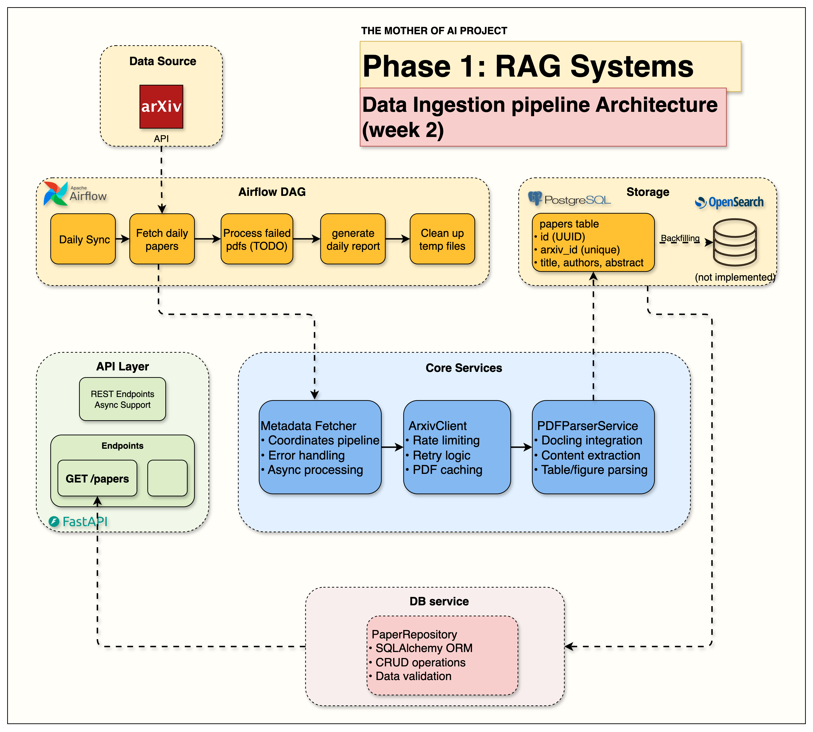

# Airflow

Weekday pipeline for fetching arXiv papers, reading PDFs, and indexing them for hybrid search.

<p align="center">
  
</p>

## DAGs

- `hello_world_dag.py` checks that Airflow can reach the API and PostgreSQL.
- `arxiv_paper_ingestion.py` runs Monday to Friday at 06:00 UTC.

```
airflow/
├── Dockerfile
├── entrypoint.sh
├── requirements-airflow.txt
└── dags/
    ├── hello_world_dag.py
    ├── arxiv_paper_ingestion.py
    └── arxiv_ingestion/
        ├── common.py
        ├── setup.py
        ├── fetching.py
        ├── indexing.py
        └── reporting.py
```

## Pipeline

1. Check PostgreSQL, the arXiv client, and the PDF parser.
2. Fetch `cs.AI` papers and store the parsed text.
3. Chunk the text, embed it, and index it in OpenSearch.
4. Write a short report and delete PDFs under `/tmp` that are older than 30 days.

The UI is at http://localhost:8080. The first start creates an admin user with username `admin` and password `admin`.
