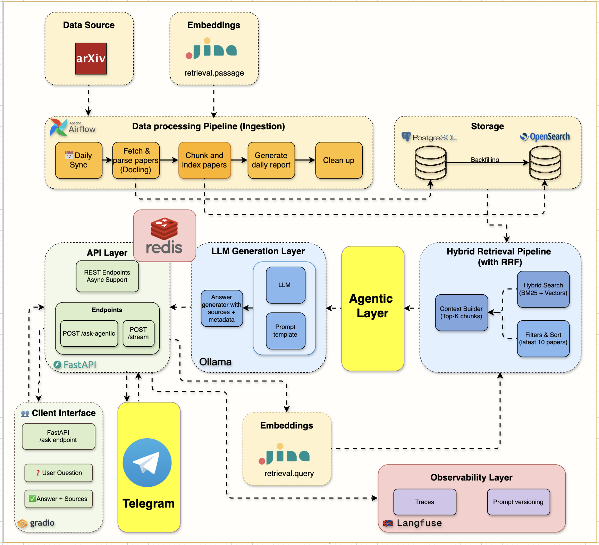

# Agent and Telegram

Runs a LangGraph flow that checks the question, retrieves passages, grades them, and rewrites the query when the passages do not fit. A question outside CS/AI/ML papers is refused. The Telegram bot can call the same flow, and it stays off unless a bot token is set.

  

Open `agentic_rag.ipynb`.
