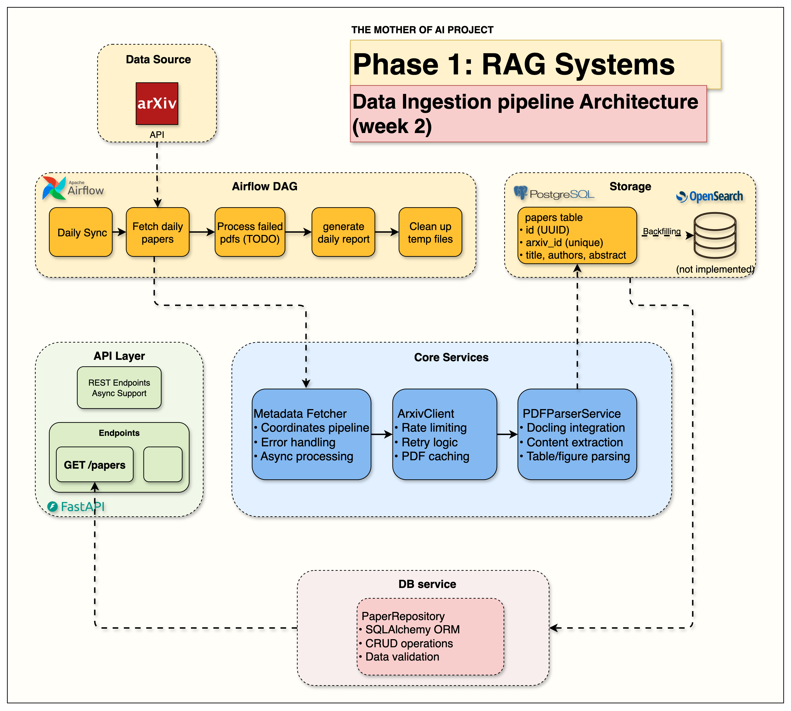

# Paper ingestion

Fetches arXiv papers, reads the PDFs with Docling, and stores the records in PostgreSQL. A PDF longer than 30 pages is stored from the abstract.

  

Open `arxiv_ingestion.ipynb`.
